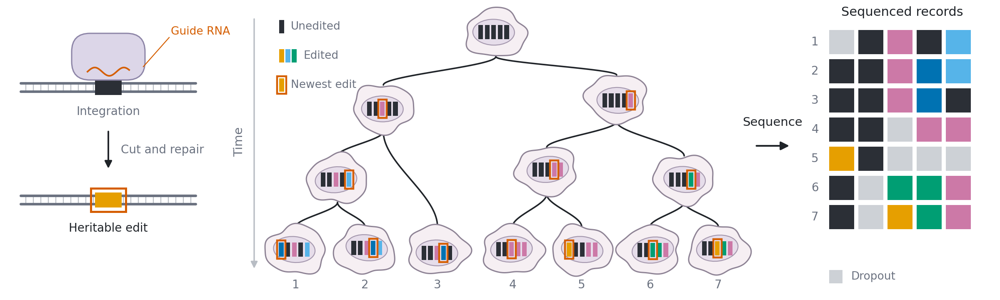
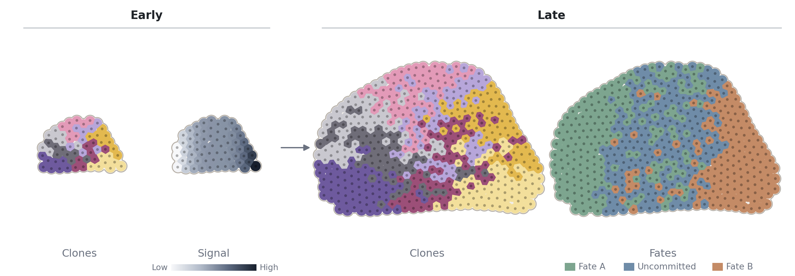
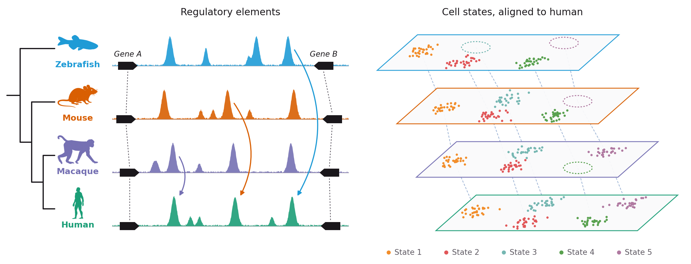

**I am on the academic job market in 2026–27.** My [CV is here](/assets/pdf/Weixiang_Fang_CV.pdf).

My research asks how cells decide their fates, and how what model organisms reveal about these decisions can be carried into human. I develop statistical and machine learning methods for data from emerging genomics technologies, focusing on genomic records, the edits an engineered recorder writes into a cell's own DNA.

I am a postdoctoral fellow in the [Kalhor Lab](https://kalhorlab.bme.jhu.edu) at Johns Hopkins, and earned my **PhD in Biostatistics** at Johns Hopkins with [Dr. Hongkai Ji](https://jilab.org).

I developed **[Quantitative Fate Mapping](/publications/)** (*Cell*, 2022), which recovers when progenitors commit and how many cells go to each fate, and **[FUNCODE](/software/)** for the ENCODE Consortium, which scores whether a regulatory element's activity is conserved between human and mouse.

### Research Areas

  

    <h4>Reading the history of cells from their DNA</h4>
    
Engineered recorders now write each cell's history into its own DNA as it divides. I build statistical and machine learning models that read those records back into the tree of divisions that built a tissue, at the scale of whole embryos.

    
  

  

    <h4>What decides a cell's fate</h4>
    
A cell's future depends both on its own state and on the signals around it. Building on my branching process model of cell lineage, I am developing a virtual embryo model that asks how much of a cell's fate is driven by what signals, and how much can still be changed.

    
  

  

    <h4>Across species, and into human</h4>
    
Transcription factors and gene networks are widely shared across animals, while the regulatory elements they act on turn over. I develop deep learning models of regulatory sequence that align these elements across species, to learn what evolution keeps and changes in fate decisions, and to carry that knowledge into human.

    
  

